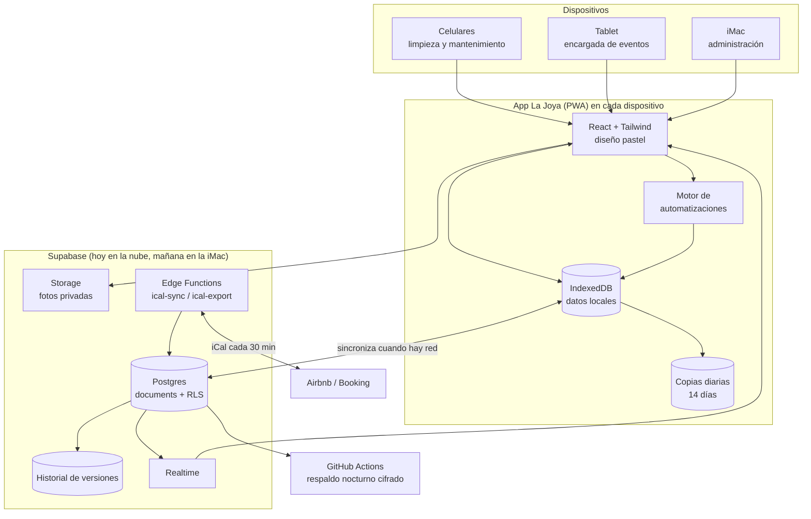
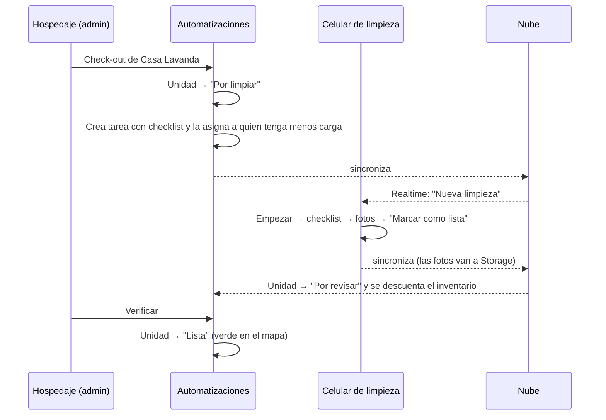

# Arquitectura

## Panorama



## Decisiones clave

| Decisión | Por qué |
|---|---|
| **PWA** en lugar de apps nativas | Un solo código para iPhone, Android, tablet e iMac. No requiere App Store, cuota de Apple ni Xcode. |
| **Offline-first** (IndexedDB → nube) | En el rancho la señal no llega igual a todos lados. Todo se guarda al instante en el dispositivo y se sube después. |
| **Una tabla `documents`** (colección + id + JSON) | La sincronización es genérica y robusta: cada registro se resuelve por separado y gana el cambio más reciente, también validado en el servidor. |
| **Seguridad en la base de datos (RLS)** | Aunque alguien manipule la app, Postgres solo deja leer o escribir lo que permite su rol. |
| **Supabase** | Postgres administrado con Auth, Realtime y Storage, y plan gratuito. Es de código abierto: se puede instalar en la iMac para trabajar en red local. |
| **Cloudflare Workers** | Hosting gratuito que permite uso comercial (Cloudflare recomienda Workers en lugar de Pages para proyectos nuevos), con HTTPS y encabezados de seguridad (`public/_headers`). El plan Hobby de Vercel prohíbe el uso comercial. |
| **Mapa 3D procedural** (three.js) | Una maqueta ligera trazada de la vista satelital, sin modelos pesados, que corre fluida en celulares. Los modelos NVIDIA SimReady se descartaron: son OpenUSD de alto detalle, pensados para Omniverse y no para la web móvil. |

## Sincronización (detalle)

| Pieza | Cómo funciona |
|---|---|
| **Primero el dispositivo** | Cada cambio se guarda al instante en IndexedDB, en una llave por colección. Así guardar es rápido aunque haya muchas fotos. |
| **Combinación por campo** | Cada campo lleva su propia marca de tiempo (`_ft`). Si dos personas editan campos distintos del mismo registro, se combinan sin perder nada. Si editan el mismo campo, gana la edición más reciente. Lo hace igual el cliente (`mergeDocs`) que el servidor (trigger `documents_lww`). |
| **Pestaña líder** | Con varias pestañas abiertas en un equipo, solo una habla con la nube (Web Locks). Las demás se enteran por `BroadcastChannel` y no hay trabajo doble. |
| **Subida** | Va en lotes de 200 y reintenta con espera exponencial y aleatoria, de 1 s a 60 s. Si el rol no tiene permiso sobre una fila (RLS), esa fila se aparta y se reporta sin frenar las demás. |
| **Bajada** | Usa un cursor por `updated_at` del servidor y el tiempo real (Realtime). Al reconectarse recupera lo que se perdió. Además revisa cada 45 s y al volver a la app. |
| **Presencia** | Muestra quién del equipo está conectado, en qué sección y desde qué dispositivo. |
| **Diagnóstico** | En *Ajustes → Nube* revisa servidor, rol, seguridad, fotos, tiempo real y latencia. |
| **Vinculación por QR** | El administrador muestra un código; el celular nuevo lo escanea y queda con el servidor configurado. Solo falta la cuenta de la persona. |

## PWA

- **Actualizaciones:** se buscan cada hora y aparece "Hay una versión nueva · Actualizar". El usuario decide cuándo actualizar, así nunca se pierde una pantalla a medias.
- **Instalación:** la tarjeta aparece desde la segunda visita. En iPhone muestra una guía de tres pasos.
- **Insignia:** el ícono de la app muestra los avisos sin leer (Badging API).
- **Push:** el service worker propio (`src/sw/sw.ts`, que también maneja la app sin internet y las actualizaciones) recibe los avisos, y la función `push-send` los envía cuando la base crea un aviso (trigger `notify_push`).
- **Pantalla encendida:** se mantiene activa durante la limpieza y el día del evento (Wake Lock).
- **Almacenamiento persistente:** la app lo solicita para que el navegador no borre los datos locales.

## Flujo de datos de una limpieza



## Roles y permisos

| Rol | Ve | Puede escribir |
|---|---|---|
| Administración | Todo | Todo |
| Eventos | Unidades, reservas, eventos, pagos, tareas, inventario | Eventos, pagos, tareas, inventario |
| Limpieza | Unidades, reservas (sin montos), tareas, inventario | Unidades (estado), tareas, fotos, inventario |
| Mantenimiento | Igual que limpieza | Igual que limpieza |

En la app, el menú y los montos se ocultan según el rol (`src/lib/meta.ts`). En el servidor, las funciones `can_read` y `can_write` de la migración SQL lo hacen obligatorio.

## Respaldos: 4 capas

1. **Dispositivo:** cada cambio se guarda al instante en IndexedDB, y la app le pide al navegador almacenamiento persistente.
2. **Copia diaria local:** se guarda una por día y se conservan las últimas 14. Se restauran desde *Ajustes → Respaldos*.
3. **Servidor:** cada versión anterior de cada registro queda en `documents_history` (180 días). La bitácora no se puede reescribir.
4. **Respaldo nocturno:** GitHub Actions hace `pg_dump`, lo cifra con AES-256 y lo guarda 30 días (`.github/workflows/respaldo-nocturno.yml`).

Además, desde *Ajustes* se descarga un archivo de respaldo, opcionalmente cifrado con contraseña (AES-GCM y PBKDF2 con 210 000 iteraciones).

## Seguridad

- **Conexiones:** HTTPS/TLS en todo. CSP estricta, HSTS, `X-Frame-Options: DENY` y `Permissions-Policy` (`public/_headers`).
- **PINs:** se guardan con hash SHA-256 y sal, nunca en texto. La sesión se bloquea por inactividad (configurable).
- **Llaves:** la app solo conoce la llave pública (anon). La llave de servicio vive únicamente en las Edge Functions.
- **Fotos:** van en un bucket privado y se ven con URLs firmadas que expiran en 1 hora.
- **Feed iCal:** está protegido con un token por unidad, comparado en tiempo constante.

## Estructura del código

```
src/
  lib/          núcleo: tipos, store (IndexedDB), sync (Supabase), automatizaciones, plano del rancho, plano de mesas, cifrado
  components/   UI pastel (ui.tsx), gráficas, AppShell, mapa 3D/2D, plano de mesas, flujos de hospedaje y limpieza
  pages/        una pantalla por módulo
supabase/       migración SQL (RLS, historial, storage) y Edge Functions (ical-sync, ical-export)
.github/        respaldo nocturno
```
